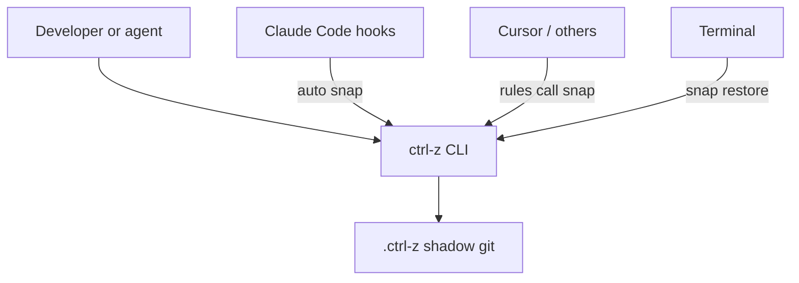

# Ctrl+Z

**Ctrl+Z for your whole project. Built for the moment your AI agent goes rogue.**

AI coding agents (Claude Code, Cursor, Codex, Gemini CLI, Windsurf, Cline…) edit dozens of files in seconds. Sometimes they delete the wrong file, rewrite code you never mentioned, or break something that worked ten minutes ago. Ctrl+Z quietly snapshots your project *before* each change, so one command puts everything back.

```
> ctrl-z restore
Restored project to: "before Edit src/auth.js" (2 min ago)
  - 3 files restored
  - 1 file the agent created was removed
```

Works for **everyone** with Node.js + git — not locked to one agent. Hooks give automatic snapshots where the host supports them; elsewhere you (or the agent) run `ctrl-z snap` before risky work.

---

## Contents

1. [What it does](#what-it-does)
2. [Install](#install)
3. [Commands](#commands)
4. [How it works](#how-it-works)
5. [What it can and cannot undo](#what-it-can-and-cannot-undo)
6. [Agent support](#agent-support)
7. [Tech decisions](#tech-decisions)
8. [Repo structure](#repo-structure)
9. [FAQ](#faq)
10. [Development](#development)
11. [License](#license)

---

## What it does

- Takes snapshots of your project (automatic with hooks, or on demand via CLI).
- Stores them in a hidden **shadow git repo** (`.ctrl-z/`), so your real git history is never touched — and it works even if the project is not a git repo.
- Lets you list, diff, restore, and redo.
- Skips junk (`node_modules`, build output, huge files, `.env`-style secrets) and cleans up old snapshots automatically.

## Install

**Requirements:** Node.js 18+ and `git` on your PATH. Zero npm dependencies.

**Any agent or plain terminal (CLI):**

```bash
npx ctrl-z init
npx ctrl-z snap -m "starting point"
```

Or clone this repo and run locally:

```bash
node src/cli.js init
node src/cli.js snap -m "starting point"
```

**Claude Code (plugin — automatic snapshots):**

```text
/plugin marketplace add <your-github-user>/CTRL-Z
/plugin install ctrl-z@ctrl-z
```

(Or install from a local path while developing.)

**Cursor / Windsurf / Cline (rules — agent must snap):**

Copy `AGENTS.md`, `.cursor/rules/ctrl-z.mdc`, or `.clinerules/ctrl-z.md` into your project. These tell the agent to run `npx ctrl-z snap` before risky edits. This is weaker than hooks — be honest about that.

## Commands

| CLI | Slash (Claude Code) | What it does |
|---|---|---|
| `ctrl-z snap [-m label]` | _(auto via hooks)_ | Take a snapshot |
| `ctrl-z restore [n]` | `/undo` `/undo 3` | Go back one (or n) steps |
| `ctrl-z list` | `/undo-list` | Show recent snapshots |
| `ctrl-z diff [n]` | `/undo-diff` | Show changes since snapshot n |
| `ctrl-z redo` | `/redo` | Undo your last undo |
| `ctrl-z status` | `/undo-status` | Snapshot count, disk used, active? |
| `ctrl-z prune` | `/undo-clean` | Delete old snapshots now |
| `ctrl-z off` / `on` | — | Disable / enable snapshots |
| `ctrl-z reset --yes` | — | Delete `.ctrl-z/` entirely |

Flags: `--dry-run` (with restore), `--yes` / `-y` (skip confirm), `--cwd <dir>`.

## How it works

1. **Snap.** Save the current project tree into `.ctrl-z/repo.git` as an independent ref `refs/snaps/<id>`. If nothing changed, skip (except safety snaps for undo).
2. **Label.** Each snapshot records a label plus JSON metadata (tool, file, session, time).
3. **Restore.** Rewrite the working folder to match the chosen snapshot, including deleting files created after it. A safety snapshot labeled `before undo` is taken first so every undo is itself undoable (`redo`).



## What it can and cannot undo

**Can undo:** edits, deletions, and creations of files inside the project folder.

**Cannot undo:**

- Files outside the project folder.
- Databases, API calls, emails, deployments, or anything already sent over the network.
- Files skipped by ignore rules (e.g. `.env`, `node_modules`) — skipped on purpose.
- Changes made while Ctrl+Z was `off`.

## Agent support

| Agent | Snapshots | How |
|---|---|---|
| Claude Code | Automatic | Plugin hooks (`PreToolUse`, `UserPromptSubmit`) |
| Cursor | Manual / rule-guided | `.cursor/rules` + `AGENTS.md` → agent runs `ctrl-z snap` |
| Windsurf / Cline / Aider | Manual / rule-guided | `AGENTS.md` / `.clinerules` |
| Any terminal | Manual | `npx ctrl-z snap` / `restore` |

## Tech decisions

| Decision | Choice | Why |
|---|---|---|
| Language | Node.js, no dependencies | Works on Windows, Mac, and Linux |
| Storage | Shadow git in `.ctrl-z/` | Fast, deduplicated, no risk to the real repo |
| Snapshot style | One commit per snap as `refs/snaps/<id>` | Easy to prune without rewriting history |
| Ignore rules | `.gitignore` + built-in list | Avoids `node_modules` and secrets |
| Size guard | Skip files over 5 MB (configurable) | Keeps snaps fast |
| Retention | Keep last 50 **or** 7 days (union) | Simple and predictable |
| Lock | `.ctrl-z/lock` | Safe under concurrent hooks |

Config overrides: `.ctrl-z/config.json` (e.g. `maxFileBytes`, `keepCount`, `keepDays`, `maxStorageBytes`).

## Repo structure

```
CTRL-Z/
├── README.md
├── LICENSE
├── package.json
├── AGENTS.md
├── .cursor/rules/ctrl-z.mdc
├── .clinerules/ctrl-z.md
├── .plugin/
│   ├── plugin.json
│   └── marketplace.json
├── skills/ctrl-z/SKILL.md
├── commands/          # Claude Code slash commands
├── hooks/             # Claude Code hooks
├── src/               # CLI + engine
├── test/
├── examples/demo.md
└── scripts/bench.js
```

## FAQ

**Does it touch my git history?**  
No. Snapshots live only in `.ctrl-z/repo.git`.

**Does it upload anything?**  
No. Everything stays local. Do not push `.ctrl-z/` anywhere.

**How much disk does it use?**  
Depends on project size and churn. Run `ctrl-z status` or `npm run bench`. Retention and a 500 MB disk guard prune aggressively when needed.

**Will it restore `.env`?**  
No — secret/ignored files are skipped on purpose.

## Development

```bash
node src/cli.js version
npm test
node scripts/bench.js --quick
```

### Phase checklist (build plan)

- [x] Phase 0 — package scaffold, ESM, bin `ctrl-z`
- [x] Phase 1 — shadow git snap / restore / list / diff / redo / prune
- [x] Phase 1.5 — Cursor / AGENTS / Cline rule files
- [x] Phase 2 — Claude Code plugin manifests, hooks, commands, skill
- [x] Phase 3 — lock, dry-run, off/on/reset, disk guard, corruption recovery, size guard
- [x] Phase 4 — unit tests, chaos test, bench script
- [ ] Phase 5 — demo GIF + launch polish (record when ready)
- [ ] Phase 7 — npm publish + Show HN (when you decide to launch)

### Testing checklist

- [ ] Fresh folder, not a git repo: snapshot, break things, restore
- [ ] Existing git repo: restore does not touch real `.git`
- [ ] Delete a whole folder, restore
- [ ] New files removed on restore
- [ ] Binary + CRLF + unicode names
- [ ] Undo then redo
- [ ] `ctrl-z off` then snap skipped
- [ ] Windows paths (primary)

## Real scare stories

Write your own after dogfooding. Keep them short and honest — they travel better than feature lists.

## License

MIT.
